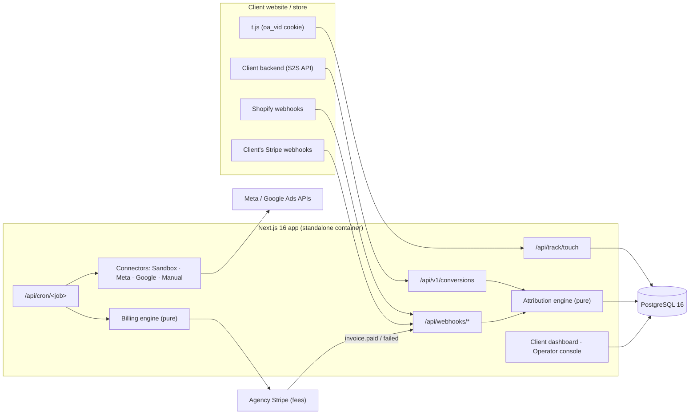

# Outcome Ads — results-based ad agency platform

> An agency that builds and runs your ad campaigns and only reports on the revenue. No retainers,
> no minimums, no strategy meetings.

Clients pay their ad spend directly to Meta / Google / TikTok on accounts they own. Our operators
build and run the campaigns. The client sees **one number** — revenue the ads generated — and pays a
performance fee: a percentage of attributed revenue (10% by default, stored per agreement in basis
points). "Outcome Ads" is a working name, configurable with `NEXT_PUBLIC_APP_NAME`.

## Features

- **Public site** — landing page (how it works, "pay only on revenue", fee calculator), FAQ, apply
  form (rate limited, honeypot, operator alert), agreement template and privacy summary.
- **Client onboarding** — sign up → organization (single currency) → intake (website, offer, AOV,
  margin, geos, **monthly ad-spend cap**, creative links) → **performance agreement** (version,
  accepted-by, timestamp, IP, user agent, full rendered text and its SHA-256) → tracking script +
  revenue source → payment method via **Stripe Checkout in setup mode** (Stripe customer per org).
  Multi-user orgs: owners invite members by email.
- **First-party tracking** — `/t.js` (≈2 KB, dependency free) captures `utm_*`, `gclid`, `fbclid`,
  `ttclid` and our `oa_cid`, keeps an `oa_vid` first-party cookie and posts to
  `POST /api/track/touch` (per-org public key, origin allow-list, CORS, rate limited, Zod validated).
  On Shopify storefronts it stores the visitor id as a cart attribute.
- **Revenue sources** — server-to-server `POST /api/v1/conversions` (secret API key, only its hash
  stored), Shopify `orders/paid` + `refunds/create` webhooks (HMAC-SHA256), and the client's own
  Stripe webhooks (`checkout.session.completed`, `charge.refunded`). Per-org secrets are encrypted
  with AES-256-GCM under a key id so keys can be rotated.
- **Attribution engine** (pure, heavily unit tested) — last paid-media touch inside the agreement's
  click window; only touches carrying one of our campaign ids (or a paid click id from a platform we
  run) count; organic/direct revenue is never attributed; dedupe by (org, source, order id); refunds
  become negative adjustments linked to the order; one currency per org, integer minor units.
- **Client dashboard — revenue only, by design** — attributed revenue this month (hero number),
  30-day SVG chart with hover + table view, attributed-order count, full auditable order list, fee
  accrued, refund credit, invoices with Stripe links, tracking status + snippet, agreement. No
  impressions, CTR, CPC or ROAS anywhere a client can see.
- **Operator console** — all clients with onboarding status, revenue vs spend, ROAS and cap pacing;
  campaign CRUD with connector actions (launch, pause, resume, budget, spend sync) and generated
  tracking templates; spend-vs-revenue chart; offers (fee rate / window); ad-platform OAuth; alerts;
  billing overview (overdue flags); applications; job runs; audit log; admin role management.
- **Ad-platform connectors** — one interface `{ createCampaign, setStatus, setDailyBudget,
fetchDailySpend }`: deterministic `SandboxConnector`, `MetaMarketingConnector` (Graph API),
  `GoogleAdsConnector` (REST `googleAds:searchStream` + mutates), `ManualConnector` (operator acts in
  the platform UI; the app raises an alert). Real connectors are used only when credentials exist.
- **Jobs** (idempotent; `POST /api/cron/<job>` with `CRON_SECRET`, or `npm run job:<name>`):
  `sync-spend`, `budget-guard`, `monthly-billing`, `dunning`, `weekly-revenue-report`, `cleanup`.
- **Billing** — monthly statements (UTC calendar months), fee = round-half-up(revenue × bps / 10 000)
  per rate, refunds of already-billed revenue become carried-forward credits (never negative
  invoices), zero fee → no invoice, unique (org, period) + advisory lock + Stripe idempotency keys,
  `invoice.paid` / `invoice.payment_failed` webhooks, dunning pauses campaigns after N days.

## Architecture



More detail: [docs/ARCHITECTURE.md](docs/ARCHITECTURE.md).

## Quickstart

Requirements: Node 22 (`.nvmrc`), npm 10, Docker (for Postgres + Mailpit).

```bash
cp .env.example .env
docker compose up -d db mailpit      # Postgres on :5432 (DB_PORT to override), Mailpit on :1027/:8027
npm ci
npm run db:migrate
npm run db:seed                       # prints demo credentials
npm run dev                           # http://localhost:3000 (set APP_URL accordingly)
```

Demo credentials created by the seed (local only):

| Role                          | Email                        | Password                |
| ----------------------------- | ---------------------------- | ----------------------- |
| Admin                         | `admin@outcome-ads.test`     | `admin-password-123`    |
| Operator                      | `operator@outcome-ads.test`  | `operator-password-123` |
| Client (onboarded, with data) | `owner@acme-outdoor.test`    | `client-password-123`   |
| Client (mid-onboarding)       | `owner@bluebird-coffee.test` | `client-password-123`   |

To send email through Mailpit set `SMTP_HOST=localhost` and `SMTP_PORT=1027` (UI at
http://localhost:8027). With `SMTP_HOST` empty, emails are logged instead.

## Scripts

| Script                                     | What it does                                                                                                                      |
| ------------------------------------------ | --------------------------------------------------------------------------------------------------------------------------------- |
| `npm run dev`                              | Next.js dev server                                                                                                                |
| `npm run build`                            | Production build (`output: standalone`) + bundles `dist/migrate.mjs` and `dist/job.mjs`                                           |
| `npm start`                                | Serve the production build (`next start`)                                                                                         |
| `npm run lint` / `format` / `format:check` | ESLint 9 (flat config) / Prettier                                                                                                 |
| `npm run typecheck`                        | `tsc --noEmit` (strict)                                                                                                           |
| `npm test`                                 | Vitest: unit + integration (integration uses `TEST_DATABASE_URL`)                                                                 |
| `npm run test:unit` / `test:integration`   | One Vitest project                                                                                                                |
| `npm run test:e2e`                         | Playwright smoke against `next start -p 3003` on the re-seeded test DB                                                            |
| `npm run db:generate`                      | Generate a SQL migration from `src/db/schema.ts` (commit it)                                                                      |
| `npm run db:migrate`                       | Apply `drizzle/` migrations to `DATABASE_URL`                                                                                     |
| `npm run db:seed [-- --reset]`             | Admin, operator and demo data (`--reset` truncates, dev/test DBs only)                                                            |
| `npm run secrets:rotate`                   | Re-encrypt stored integration secrets with the current key                                                                        |
| `npm run job:<name>`                       | Run a job: `sync-spend`, `budget-guard`, `monthly-billing` (`-- --period=YYYY-MM`), `dunning`, `weekly-revenue-report`, `cleanup` |

## Environment variables

Every variable is validated in [`src/env.ts`](src/env.ts); `.env.example` documents each one.
`SKIP_ENV_VALIDATION=1` relaxes validation for `next build` / CI only: a running production server
(`NODE_ENV=production` outside the `next build` phase) ignores it and refuses to start with missing
or invalid values.

| Variable                                                                                                                                   | Required      | Purpose                                                               |
| ------------------------------------------------------------------------------------------------------------------------------------------ | ------------- | --------------------------------------------------------------------- |
| `APP_URL`                                                                                                                                  | yes           | Public base URL (links, webhook URLs, OAuth redirects, `t.js`)        |
| `NEXT_PUBLIC_APP_NAME`                                                                                                                     | no            | Product name (build-time)                                             |
| `DATABASE_URL`                                                                                                                             | yes           | Postgres connection string                                            |
| `DATABASE_POOL_MAX`, `DATABASE_SSL`                                                                                                        | no            | Pool size; require TLS to the DB                                      |
| `TEST_DATABASE_URL`                                                                                                                        | tests         | Integration/E2E database (must end in `_test`)                        |
| `BETTER_AUTH_SECRET`, `BETTER_AUTH_URL`                                                                                                    | yes / no      | Session signing secret (≥ 32 chars); auth base URL                    |
| `DATA_ENCRYPTION_KEY`, `DATA_ENCRYPTION_KEY_ID`, `DATA_ENCRYPTION_PREVIOUS_KEYS`                                                           | yes / no / no | AES-256-GCM key (32 bytes base64), its id, old keys for rotation      |
| `CRON_SECRET`                                                                                                                              | yes           | Bearer token for `/api/cron/*`                                        |
| `STRIPE_SECRET_KEY`, `STRIPE_WEBHOOK_SECRET`                                                                                               | prod          | Agency Stripe account (fees) and its webhook secret                   |
| `PAYMENTS_MODE`                                                                                                                            | no            | `stripe` or `test-bypass` (ignored when `NODE_ENV=production`)        |
| `SMTP_HOST`, `SMTP_PORT`, `SMTP_USER`, `SMTP_PASSWORD`, `SMTP_SECURE`, `EMAIL_FROM`                                                        | prod          | Outbound email                                                        |
| `OPERATOR_ALERT_EMAIL`                                                                                                                     | no            | Alert recipient (default: all operators)                              |
| `DEFAULT_FEE_RATE_BPS`, `DEFAULT_ATTRIBUTION_WINDOW_DAYS`, `DUNNING_GRACE_DAYS`                                                            | no            | Commercial defaults (1000 bps, 7 days, 14 days)                       |
| `AD_CONNECTOR_FALLBACK`                                                                                                                    | no            | `sandbox` (dev/demo) or `manual` (production until APIs are approved) |
| `META_APP_ID`, `META_APP_SECRET`, `META_GRAPH_API_VERSION`                                                                                 | optional      | Meta Marketing API                                                    |
| `GOOGLE_ADS_CLIENT_ID`, `GOOGLE_ADS_CLIENT_SECRET`, `GOOGLE_ADS_DEVELOPER_TOKEN`, `GOOGLE_ADS_LOGIN_CUSTOMER_ID`, `GOOGLE_ADS_API_VERSION` | optional      | Google Ads API                                                        |
| `LOG_LEVEL`                                                                                                                                | no            | pino level                                                            |

## Testing

- **Unit** (`tests/unit`) — attribution rules and window boundaries, touch classification, refunds,
  fee rounding, credits across periods, multi-currency rejection, money parsing, UTC periods,
  AES-GCM envelopes and rotation, Shopify HMAC, OAuth state, payload normalisation for all revenue
  sources, connectors' request construction/response parsing with mocked `fetch`, the `t.js` script
  executed in a VM, budget/dunning/report logic.
- **Integration** (`tests/integration`, real Postgres `ad_agency_test`, migrated in global setup,
  truncated between tests) — touch + conversion → attribution → dashboard API numbers; Shopify /
  client-Stripe / S2S signature checks and dedupe; refund adjustments; monthly billing idempotency
  (sequential and concurrent) with Stripe mocked at the SDK boundary; credits; invoice webhooks;
  dunning; budget guard pausing via `SandboxConnector`; authorization (clients vs operator routes,
  org A vs org B, role self-assignment, cron secret, rate limits).
- **E2E** (`tests/e2e`) — client signs up → onboarding → accepts agreement → operator creates a
  campaign → tracked click + order through the public APIs → dashboard shows `$123.45`.

```bash
npm test                 # needs Postgres with an ad_agency_test database
npm run build && npm run test:e2e
```

## Deployment (summary)

The app ships as a single container (`Dockerfile`, Next.js standalone, non-root, `HEALTHCHECK`):

```bash
docker build -t outcome-ads .
docker run --rm -e DATABASE_URL=... outcome-ads node migrate.mjs     # migrations
docker run -p 3000:3000 --env-file .env outcome-ads                  # app
docker run --rm --env-file .env outcome-ads node job.mjs sync-spend  # a job, if not using HTTP cron
```

CI (`.github/workflows/ci.yml`) runs lint, format, typecheck, migrations, unit + integration tests,
build, Playwright and a Docker build/start check. `deploy.yml` pushes `ghcr.io/<repo>:<sha>` and
`:latest`, runs migrations with `PRODUCTION_DATABASE_URL` and calls `DEPLOY_HOOK_URL` (both skipped
with a notice when unset). Vercel + Neon, Render/Fly/Railway, Stripe webhooks, cron and backups are
covered in [docs/DEPLOYMENT.md](docs/DEPLOYMENT.md).

## Documentation

- [docs/ARCHITECTURE.md](docs/ARCHITECTURE.md) — modules, data model, attribution & billing rules
- [docs/DEPLOYMENT.md](docs/DEPLOYMENT.md) — containers, Vercel + Neon, Stripe, cron, ad-platform access
- [docs/RUNBOOK.md](docs/RUNBOOK.md) — on-call: health, logs, rollback, secrets, restores, webhook replay
- [docs/LAUNCH_CHECKLIST.md](docs/LAUNCH_CHECKLIST.md) — what a founder must do before real customers
- [SECURITY.md](SECURITY.md) · [CONTRIBUTING.md](CONTRIBUTING.md)

## Pinned versions

TypeScript `~5.9.3` (TypeScript 7 breaks Next.js / typescript-eslint), ESLint 9 (flat config with
`eslint-config-next`), `@playwright/test ~1.56.0` (matches the pre-installed Chromium build).

## License

Proprietary — see [LICENSE](LICENSE).
